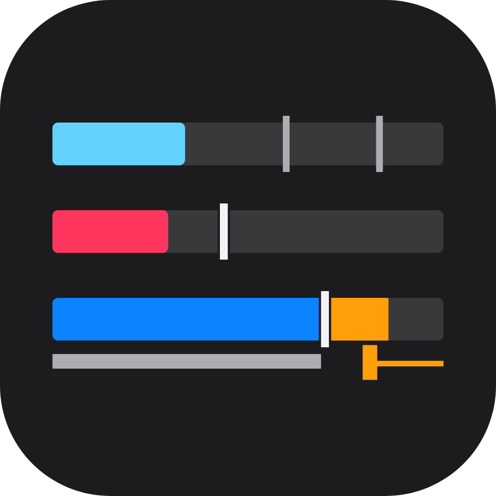
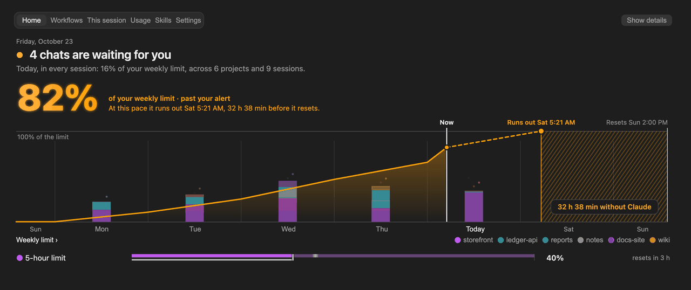
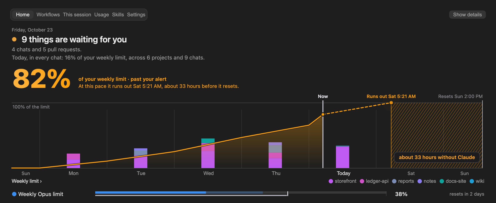
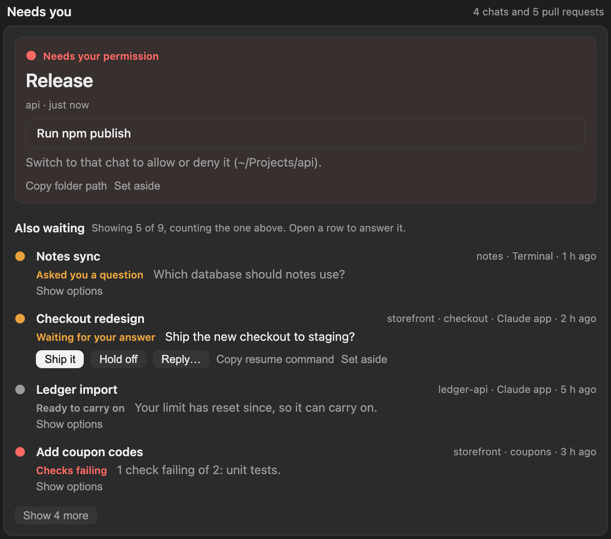
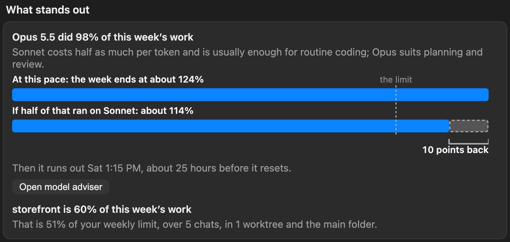
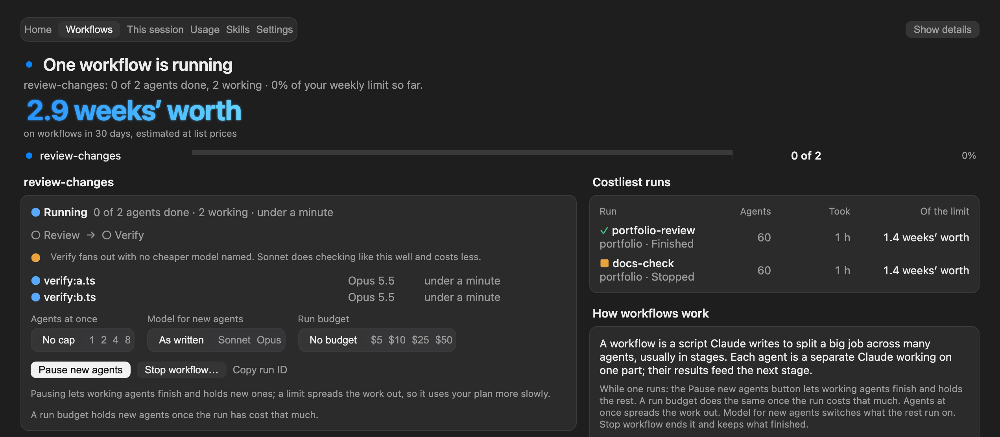
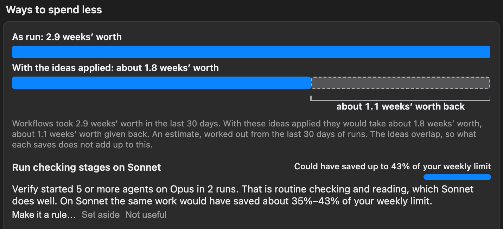
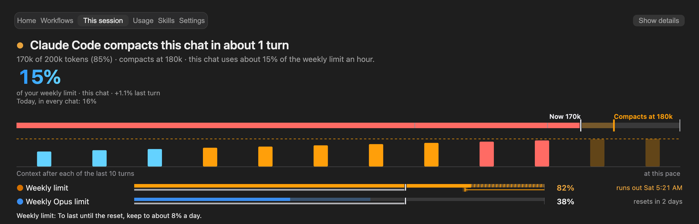
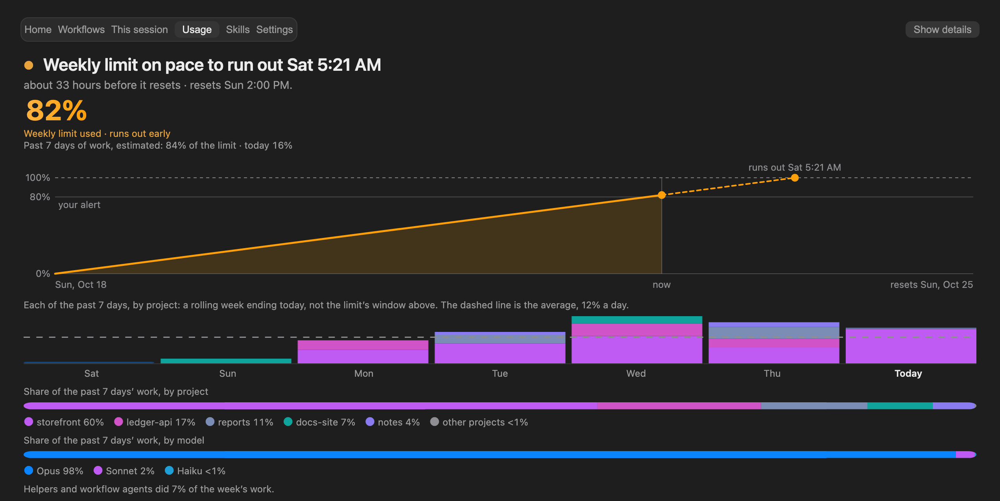
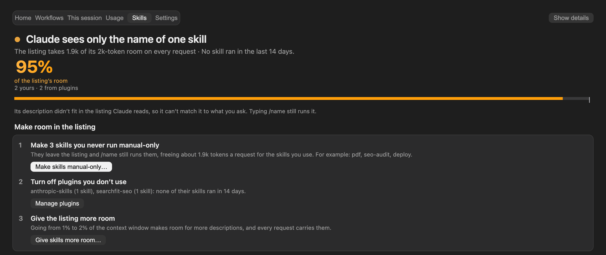

# ToBeBestMe

**A mod that runs inside Claude Code itself.** Not a separate app, service, website, command-line tool or account: it changes Claude Code's own interface, with a pane beside the chat, a line above the prompt, a tool Claude answers from, and alerts through Claude Code's own channel. There is no server, no sign-up and no API key, and it runs on your computer.

What it shows: what's waiting for you, what your week has left, and what every workflow is doing, across all your Claude Code projects. It is for people who keep several projects going at once, on a Pro or Max plan or an API key, and want to stop losing track of which chat asked a question, when a limit will run out, and what a workflow is about to cost.



```
/plugin install tobebestme --marketplace vradulthub-cloud/tobebestme
```

[Landing page](https://tobebestme.vercel.app) · [What it reads and sends](SECURITY.md) · [Why it exists](DESIGN.md) · [Changelog](CHANGELOG.md)

ToBeBestMe is an independent open-source project, not made by or affiliated with Anthropic. Claude and Claude Code are trademarks of Anthropic, PBC.

It tracks the three things every chat spends, and none of them is in view while you work:

- **Usage limits:** the weekly limit on Claude plans, and a model's own weekly limit where there is one.
- **Money:** what each request costs on an API key or team billing.
- **Context:** the conversation Claude re-reads on every turn. As it grows, each turn costs more.

## What you get

Type `/tobebestme` to open the pane. It has six tabs (Home, Workflows, This session, Usage, Skills and Settings); keys 1 to 6 switch between them in the terminal. Screenshots show sample data.

### Home: the week, and what needs you



Home reads Claude Code's own records for every project on the computer, including chats that never ran ToBeBestMe.

- **One drawing of the week.** The weekly figure and a forecast sentence, each day's work by project, the line of use so far, the dashed line to where the limit runs out, and the hours you would be without Claude before it resets. Press a day or a project to pick it out; the rest step back and a line says what it held.
- **Needs you.** Every chat that stopped for you in the last week, most pressing first: a permission prompt, a question, a plan to approve, a usage limit, a pull request waiting. The most urgent is a card of its own. In the desktop app a suggested reply shows the whole message and asks before it sends; **Reply…** takes your own words. Elsewhere, **Copy resume command** carries the chat on in a terminal.
- **Pick up where you left off.** The latest chat in each project, with its last message, branch, pull request and loose ends such as *3 files changed, not committed*.
- **What stands out.** Up to three plain observations. A saving is drawn before you act on it: the week as run, against the week with the idea applied.
- **Pull requests, from GitHub.** When the GitHub CLI (`gh`) is installed and signed in, your open pull requests that need you join Needs you: review requested, changes requested, checks failing, merge conflicts, and ready to merge, each with a button to open it and one to copy its link. They are read in the background at most every five minutes. With no `gh`, or not signed in, nothing is shown and Settings › What ToBeBestMe reads says why.
- **Projects, open chats and running workflows.**





### The weekly report card

On Usage, the week as one image to post: the weekly figure, each day by project, days used and your streak, top projects, models, workflows and savings. **Save report card** writes an SVG to `~/.claude/tobebestme/reports/` (and a PNG when `rsvg-convert`, ImageMagick, Inkscape or macOS Quick Look is there) and copies a few lines of text to paste with it. **Hide project names** swaps them for Project 1, 2, 3 first. Nothing is uploaded.

### On your phone

Attach a phone and the mod draws a short lobby in the mobile app: what is waiting for you (with the replies the chat itself suggested, each confirmed before it is sent), the limit that binds first and when it runs out, and what is running. The app has no text field yet, so replies are the suggested buttons.

### Workflows

A workflow is a script Claude writes to split a big job across many agents. One run can start hundreds of agents and go for hours.



- **Before it starts:** what the run is, its stages, how many agents it starts, a likely cost range from your own finished runs, and anything worth changing. With **Check each workflow before it runs** set to **Ask me first**, Claude waits for your answer in the chat: **Run workflow**, **Run every agent on Sonnet** (every agent, including stages the script put on a stronger model) or **Don’t run**.
- **While it runs:** every agent and what it is doing this moment, its model and cost. **Pause new agents**, **Agents at once**, **Model for new agents** and **Stop workflow…** act on agents that have not started; finished work is kept.
- **Afterwards:** the costliest runs, and ways to spend less, each with what it would have saved on your last 30 days of runs.



**Make it a rule…** shows the line it would add to your user CLAUDE.md, as it is now and as it will be, and writes it when you press **Save change**.

### This session

Whether this conversation will make it: its cost, and the context window as a runway with a post where Claude Code compacts, a ghost for the next turns at the recent pace, and a bar per turn. Under it, ways to save, the right model for the job, a planner for long runs, what fills the context, and what is always loaded (MCP servers, memory files, skills).



### Usage

Where each limit is heading and where the week went: the forecast with the readings taken, each day by project, projects and models as split bars, then each limit's window, this chat's turns and budgets. Under *This session, to share*, **Copy chat summary** puts a short status update on the clipboard and **Save chat report** writes a fuller Markdown report to `~/.claude/tobebestme/reports/`, for a standup or a chat.



### Skills

Claude picks a skill from a listing of names and descriptions sent with every request. The listing has room for about 1% of the context window; past that, skills go to Claude as a bare name it cannot match to a request. Claude Code reports this in `/doctor` and its debug log, not in the conversation; ToBeBestMe shows it beside the chat and fixes it in one place. The tab shows whether Claude can see your skills, what ran in the last 14 days, and a check-up of your own skills.



Fixes are made in the pane, never through the conversation. **Fix description…** has the helper model write a new description, shows it beside the old one, and saves it to the skill's front matter when you press **Save change**. **Make skills manual-only…**, **Give skills more room…** and **Make it a rule…** work the same way: the setting as it is, as it will be, then Save. A file edited meanwhile is never written over.

### Settings

What ToBeBestMe does on its own, then the options as rows of preset choices with **Other…** for an exact value. The essentials show first; the button under them (for example **Show 13 advanced settings**) reveals the rest. Budgets and how costs show are set on Usage and the check before a workflow on Workflows, each beside what it governs; Settings links to them. At the foot, **Restore defaults…** puts every setting back (Claude Code reloads the mod after each one, so the dashboard may blink for a few seconds), **Reset this chat’s numbers…** clears this chat’s tallies, and **Forget stored data…** clears what the mod keeps (see Privacy).

### Accessibility

The pane is built to be used without a mouse and without color. `/tobebestme` moves the keyboard into the pane, **Tab** and **Shift+Tab** move between controls, **Enter** presses one, and **Esc** closes the pane; the line above the prompt has an **Open ToBeBestMe** button. **Show details** puts the words of every hover card in the page for keyboards, screen readers and touch, and is remembered between chats. A status is always a word and a shape as well as a color, text is held to 4.5:1 contrast on a dark and a light pane and is never under 11px, and every drawing has a text alternative. With reduced motion set, nothing animates: the entrances, the sheen and the pulse on a running workflow or waiting chat are all switched off.

## Install

You need Claude Code 2.1.308 or later (`claude --version`; `claude update` brings an older one up to date). Install it for your user and it runs in every project and chat, in the terminal and the desktop app:

```bash
claude plugin install tobebestme --marketplace vradulthub-cloud/tobebestme
```

Or at a chat's prompt: `/plugin install tobebestme --marketplace vradulthub-cloud/tobebestme`. To install from a local copy, run the same command from its folder with `--marketplace "$PWD"`.

Chats already open load it when they next start: quit and reopen the Claude app, or start a new terminal session. Then type `/tobebestme`. The first time, it reads the last 14 days of Claude Code's records in every project, once; that takes under a minute, and afterwards only what changed is read. To have the pane open by itself in every chat, turn on **Open the dashboard in every chat** in Settings.

The marketplace install copies the repository's `main` branch as it is at that moment. To run exactly one release, verify its download first: [SECURITY.md](SECURITY.md) shows how.

It was called budget-pilot before 1.2; the first time ToBeBestMe starts, it carries over what budget-pilot kept.

## What it does while you work

- **Shows a line above the prompt** in every chat. The first row says what needs you (a workflow waiting for your go-ahead, a chat waiting elsewhere, a workflow running here) or that all is fine. The second shows a small meter for context and each usage limit, then the cost here and today.
- **Uses a cheaper model when things get tight.** In Automatic mode helpers switch to it once context, a usage limit or a budget gets tight. At a reached budget the whole chat moves to it (unless you chose the model yourself), so the next request re-reads the conversation once. **A model you choose yourself always wins:** switch with `/model` and the chat stays on it.
- **Enforces budgets.** At a chat or daily budget it warns you, switches requests to the cheaper model, or holds new prompts. Slash commands still run.
- **Writes a handoff note before a compaction**, to `.claude/tobebestme/handoff.md`, and points the next prompt at it. The note is one more request over the conversation, cheap while the conversation is cached and full price after a pause, so it is skipped when the chat is nearly full, and for a compaction you did not ask for when the chat has been idle. Claude is told to leave secrets out, a reply that does not start with a Goal is not saved, and the folder’s `.gitignore` is set to ignore everything in it unless it already does. **Start fresh** writes the note, clears the chat and puts a prompt in the box (only when it is empty) that asks Claude to read the note, say what it sees and wait for your go-ahead.
- **Tells Claude where things stand.** Past the warning, each prompt carries a line so Claude keeps its steps small and saves a note.
- **Explains every workflow** as it starts, tracks each agent, and holds new agents while a run is paused or at its run budget.
- **Alerts you when this chat waits for you.** On by default and separate from *Notifications*: when Claude asks permission, asks a question or finishes and waits, you get one alert for that wait, through Claude Code's own notification channel (the computer's Notification Center where that shows no words), with a short chime Claude Code plays itself. *Say alerts aloud* adds a few spoken words. Turn it off with *Alert when this chat waits for you*. The alert for this chat says who is waiting and what kind of wait, never the command or file; a notification about another waiting chat carries its title and a short excerpt.
- **Suggests the next prompt, dimly.** Once context passes its warning (60% by default) the prompt box's dim suggestion offers `/compact` with the plan kept; after a limit warning it offers `/tobebestme-handoff`. Tab takes it. Nothing is ever typed for you, and each is offered once per crossing or window. *Suggest the next prompt* turns it off.
- **Answers when you ask Claude.** A read-only tool, `mcp__tobebestme__status`, tells Claude where your limits, context, costs and workflows stand, so "how much of my week is left?" just works. Claude loads it only when it looks for it. The overview counts the chats and pull requests waiting on you and names the busiest project of the past seven days; their titles, project names and a short excerpt (up to 160 characters) come only from its *waiting* topic, which Claude Code asks you about first unless you have allowed the tool yourself. Those words arrive as quoted data and go to the conversation, as any tool result does.
- **Notifies once per computer.** Each alert fires once, whichever chat sees it first, at most four in ten minutes. Alerts go to toasts and Recent activity, and with **Notifications** on, to your computer's Notification Center, a sound and, if you set an `https://` address such as an [ntfy](https://ntfy.sh) topic, your phone. A notification about a waiting chat carries its title and a short excerpt, and a topic on a public service can be read by anyone who guesses its name, so use a long, random one.
- **Adds a line under each answer** (what the turn cost, how much came from the cache, the chat's context and tightest limit) and **a status line**.
- **Suggests workflows** when a request looks like one, once, with its stages and a model for each. The request goes into the prompt box for you to read before sending.

## Privacy

ToBeBestMe runs on your computer, inside Claude Code. It has no server of its own, no account and no telemetry. It reads Claude Code's records in `~/.claude/projects`, `claude agents --json`, `git status` in your recent project folders, your skill and command files, and two skill settings from Claude Code's settings files. It never opens `.env` or key files.

What leaves your computer:

- **Prompts to Claude, through your own account:** when you press **Suggest more**, **Improve it** or **Fix description…**, or draft a skill (each of these sends text to a model), to write the handoff note before a compaction (Settings can turn that off), and as a five-token check when the cheaper model comes back empty. The fixes use Sonnet, falling back to your cheaper model when Sonnet gives an empty reply, refuses or returns a provider error; **Suggest more** sends your recent prompts to your cheaper model.
- **What Claude asks the status tool for:** limits, context, costs, counts of what waits and the name of the busiest project of the past seven days; and, only from its *waiting* topic (Claude Code asks you first unless you have allowed the tool), the titles, project names, short excerpts and links of the chats and pull requests waiting on you. They go to the conversation, as any tool result does.
- **A notification's words** to the `https://` address you set, if you set one. A waiting chat's title and a short excerpt are in them, and a public topic such as an ntfy.sh one can be read by anyone who knows or guesses its name: use a long, random topic, or a service that needs a sign-in.
- **A message to another chat, or archiving one,** only when you press a button for it and confirm.
- **Nothing to GitHub** beyond the GitHub CLI's own read queries (`gh pr list`, `gh auth status`) that you run on your own account, and only when `gh` is installed and signed in.
- **Lines added to your prompts** about the budget and the handoff note, as listed in [SECURITY.md](SECURITY.md).

**What it keeps.** A JSON file of its own in your Claude Code configuration folder, at most 4 MiB: spending by chat and day, usage by project, short excerpts of your recent prompts, recaps and questions (so Home can show what waits across projects), the list of running chats as `claude agents --json` last returned it, the prompts you repeat across projects that skill ideas are made from, the pull requests last read, the plan's limits as last read, the items you set aside or hid, and its own readings. Turning *Read every project* off deletes the excerpts, the list of running chats, the repeated prompts and the pull requests, and what was made from them. **Forget stored data…** on the Settings tab forgets everything it stored, spending history included, so a daily budget starts counting again from this chat; your settings and Claude Code’s own files stay.

Reading the records sends nothing anywhere. [SECURITY.md](SECURITY.md) lists everything it reads, writes, runs and sends, row by row, and how to verify an install and a download. Each release comes with `SHA256SUMS`, the zip's own SHA-256 and build provenance signed by GitHub; ToBeBestMe checks its own files against its manifest once a day, and the result is in Settings under *What ToBeBestMe reads*. v1.5.0 has no provenance and is superseded; use v1.5.1 or later. Report a vulnerability privately on the repository's Security tab.

## Reference

### Commands

`/tobebestme [home|workflows|session|context|usage|skills|settings]`, `/tobebestme-mode <auto|always|off>`, `/tobebestme-handoff`. The old names (`projects`, `spending`, `limits`) still work. `/tobebestme tour` replays the welcome tour.

### Settings

Every setting is a `userConfig` field, so it appears in Claude Code's **/config** menu (as *ToBeBestMe: …*) and in the pane: on the Settings tab, or beside what it governs (budgets and how costs show on Usage, the check before a workflow on Workflows). A change in either place saves to Claude Code's settings and reloads the mod.

| Setting | Default | Presets |
| :- | :- | :- |
| Chat budget | None | None, $5, $10, $25, $50, $100, Other… |
| Daily budget | None | None, $10, $25, $50, $100, $200, Other… |
| When a budget is reached | Cheaper model | Warn me, Cheaper model, Hold prompts |
| Alert at (usage limit) | 80% | 50, 70, 80, 90%, Other… |
| Show costs as | Automatic | Automatic, Share of limit, Dollars |
| Use the cheaper model | Automatic | Automatic, Always, Off |
| Cheaper model | Haiku | Haiku, Sonnet, Other… (any model id) |
| Warn at (context) | 60% | 40–80%, Other… |
| Line above the prompt | On | On, Off |
| Line under each answer | On | On, Off |
| Status line | On | On, Off |
| Read every project | On | On, Off |
| Check each workflow before it runs | Explain it | Explain it, Ask me first, Off |
| Run budget | None | None, $5, $10, $25, $50, Other… |
| Suggest workflows | On | On, Off |
| Notifications | Off | On, Off |
| Notify through | Both | Both, System, Claude Code |
| Alert when this chat waits for you | On | On, Off |
| Suggest the next prompt | On | On, Off |
| Pull requests and CI in Needs you | On | On, Off |
| Open the dashboard in every chat | Off | On, Off |

Advanced: cost alert every, warn when a limit will run out early, helpers always use the cheaper model, main chat too, think less past the warning, effort to use, cheaper model at context %, compact automatically at %, handoff note before compacting, keep the plan through compaction, play a sound, say alerts aloud, tell Claude where the budget stands. A web address for your phone is set in the Notifications card; it is marked sensitive, and once saved the pane shows only its host.

### Honest limits

- **Cost** is Claude Code's own ledger (`/cost`). On a subscription it is the API-price equivalent, not a bill. Home and Workflows figures are list-price estimates from token counts, so they can differ a little from `/cost`.
- **A limit's pace** is its window's own average: use so far over the time the window has run. Running out counts as early when it is at least 8% of the window before the reset (about 13 hours of a week), and no forecast or pace alert is made until that much of the window has passed.
- **Home covers this computer only.** Chats on other computers or in the cloud are not included. Where no shell runs (Windows without Git Bash), transcripts over 4 MB are left out, and the tab says how many.
- **Needs you** reads where each chat's transcript stopped. A permission prompt leaves nothing there, so only chats running right now show one.
- **Replies, archiving and the plan card use the Claude desktop app’s own session tools** (`SendMessage` and `send_message`, `archive_session`, `get_usage`). They are not part of the documented mod interface, may change without notice and are not supported by Anthropic. In a terminal, Needs you offers the resume command instead.
- **A mod can't connect MCP servers, edit memory or turn plugins off itself,** so those buttons open Claude Code's own `/mcp`, `/memory` or `/plugin` screen. Starting a workflow, resuming one, a long run and **Try /name** hand Claude a job, so they go to the conversation.
- **The desktop app's home screen isn't a place a mod can draw.** ToBeBestMe is in every chat instead: the line above the prompt, the status line and `/tobebestme`.
- **Workflow savings** are what each change would have saved on your last 30 days of runs. Sonnet's figure is exact for the same tokens; batching assumes half of a stage's cheapest agent is setup; splitting assumes half the re-reading goes. Two ideas for one stage overlap, so they don't add up.
- **Pause, Agents at once and Model for new agents** act on runs started in this chat, and on agents that have not started. A held agent waits in a short `sleep` command that Claude Code does not meter, so a pause is not a countdown. Runs in other chats are read from their folders and can only be asked to stop.
- **The forecast is redrawn at the quarter hour,** and a drawing whose data has not changed is never reloaded, so it stays still while you read it.
- **Skill listing room** is worked out the way Claude Code does it (1% of the context window, or `skillListingBudgetFraction`, or `SLASH_COMMAND_TOOL_CHAR_BUDGET`), so it is an estimate. Skill runs count `/name` typed in a prompt and Skill tool calls.
- **Tool output sizes** are estimated as characters ÷ 4; cache expiry is inferred from large cache writes after a pause; model switches can be refused by an organization's `availableModels` policy.
- **The self-check** catches a copy changed after install. A copy whose manifest was changed along with its files passes it; the release's checksums and signed provenance are what prove a download.
- On a Mac, system notifications may show as coming from Script Editor, since they go through `osascript`.

### If something's off

- **`unknown option '--marketplace'`.** Your `claude` is older than 2.1.308. Run `claude update`.
- **`hooks modules are turned off in this process`**, or the mod loads but shows nothing. An old Claude Code saved mods as off in `~/.claude.json`. Start the new one once (`claude -p "hi"` will do) and it saves the current switch.
- **It isn't in a chat.** That chat started before ToBeBestMe was installed. Start it again.
- **A finished chat still shows under Needs you.** Press **Set aside**; it comes back only if that chat asks again.
- **"Haiku isn't available on your account".** Press **Use Sonnet as the cheaper model**, or choose another in Settings.
- **The pane didn't open by itself.** Claude Code opens a pane unasked only in a window at least 144 columns wide. `/tobebestme` and **Open ToBeBestMe** above the prompt open it at any width.

## Develop

Run your working copy without installing it:

```bash
claude --plugin-dir "./tobebestme"
```

For the desktop app, name the folder in `CLAUDE_CODE_PLUGIN_DIRS` in the `env` block of `~/.claude/settings.json`. Edits to `hooks/*.js` hot-reload. Use one way or the other: installed and named there, it would load twice.

### Check it without a chat

```bash
claude plugin validate ./tobebestme   # static analysis: events hooked, API calls made, state used
claude plugin test ./tobebestme       # the test kit, which presses every button on every tab; no sign-in or network
node --test tobebestme/tests/scan.test.mjs   # the shell and awk readers, held to the JavaScript reader
cd tobebestme/e2e && npm install && npm test   # the end-to-end checks
```

The end-to-end suite uses Playwright. It draws every view in an empty chat, a busy day with long titles and branch names, and a workflow waiting for an answer, at 375, 768, 1280 and 1920 pixels, on a dark and a light pane, with boxes sized the way the app sizes them. Each view is checked for sideways scrolling, type under 11px, text drawn over text, hover cards out of view, unnamed controls, more than one primary button, and unreadable contrast. It also drives real Claude Code chats in a terminal, with notifications off and no prompts sent. `npm run test:live` adds one real two-agent workflow, with its agents on Haiku and driven from a Sonnet session (a few cents of usage).

The images in this README come from the same fixtures: `node e2e/lib/export.mjs` writes each view to `e2e/.out/pages/`, and the images are screenshots of those pages.

On a drive that isn't APFS or HFS+ (exFAT, FAT32, a network share), macOS writes `._*` sidecar files, and `claude plugin test` fails to load `tests/._tobebestme.test.ts`. Run `dot_clean ./tobebestme` first.

See [CONTRIBUTING.md](CONTRIBUTING.md) for what a change needs.

### How it's built

| File | What it holds |
| :- | :- |
| `hooks/register.js` | The hooks, workflow runs and the controls that hold their agents, the chat's numbers, spending across chats, the background read of Claude Code's transcripts, running chats, alerts, and the actions behind every button |
| `hooks/lib.js` | Settings and presets, list prices, the transcript search and per-project summary, what each chat waits for, usage-limit pace, the outlook, suggestions and their savings, skills, and the SVG charts |
| `hooks/extras.js` | Alerts, the status tool Claude answers from, pull requests read with `gh`, the weekly report card, and the phone lobby's data |
| `hooks/draw.js` | The six tabs, the line above the prompt and their hover cards, drawn from plain data for whichever surface they're on |
| `types/index.d.ts` | The `$.state` contract |
| `.claude-plugin/plugin.json` | The manifest, with every setting under `userConfig` |
| `.claude-plugin/marketplace.json` | Makes the folder (or its repository) a marketplace, so one line installs the mod |
| `.claude-plugin/integrity.json`, `SHA256SUMS` | The SHA-256 of every shipped file, written by `tools/release-manifest.mjs` for each release |
| `tests/` | The kit tests (`claude plugin test`) |
| `e2e/` | The end-to-end suite: every view in Chromium, real terminal sessions, one live workflow |

| Hook | Why |
| :- | :- |
| `session.start` | Registers the commands, loads spending, and reads every project in the background |
| `turn.step` | Switches a request's model or effort before it's sent; records tokens by model, helper and workflow agent |
| `agent.spawn` | Starts a helper on the cheaper model; holds a workflow's agent while its run is paused or at its run budget |
| `tool.call` | Counts calls, time, failures and output size per tool; records what each workflow agent is doing |
| `tool.call { tool: 'Workflow' }` | Reads the script before a run starts, estimates it, waits for your go-ahead when you asked for that, and records the run |
| `skill.prompt` | Counts which skills run |
| `prompt.submit` | Holds prompts past a budget; adds the budget line and the handoff pointer |
| `turn.start` / `turn.complete` | Marks a workflow agent done or failed; records each turn, updates today's spending, fires alerts, compacts automatically, and adds the line under the answer |
| `classic.PostModelSwitch` | Records that you switched model yourself, so a model you choose wins over automatic routing |
| `session.end` | Clears the chat's instance record, and the per-conversation state after `/clear` or a resume |
| `tool.call { tool: 'AskUserQuestion' }` | Raises the waiting alert when Claude asks you a question, and notes what else is waiting |
| `tool.call { tool: 'TaskStop' }` | Marks a workflow as stopped when it was stopped from outside the pane |
| `session.compact` | Writes the handoff note, keeps its plan in the summary, and counts the tokens freed |
| `session.measure` | Refreshes the figures, records usage-limit readings for the forecast, and updates the status line and the pane |
| `ui.render { component: 'Pane' }` | Draws the pane |
| `ui.render { component: 'AbovePrompt' }` | Draws the line above the prompt |
| `command.run` | Answers `/tobebestme`, `/tobebestme-mode` and `/tobebestme-handoff` |
| `tool.call { tool: 'mcp__tobebestme__status' }`, `tool.check` | Answers the status tool, and allows the overview without a prompt (it only reads figures); the waiting topic still asks |
| `classic.PermissionRequest`, `classic.Notification` | Alert once when this chat starts waiting for you |
| `session.attach { surface: 'mobile' }` | Draws the phone lobby |

## License

MIT, © 2026 ToBeBestMe contributors. The name and icon aren't covered by the license; see [TRADEMARKS.md](TRADEMARKS.md).
